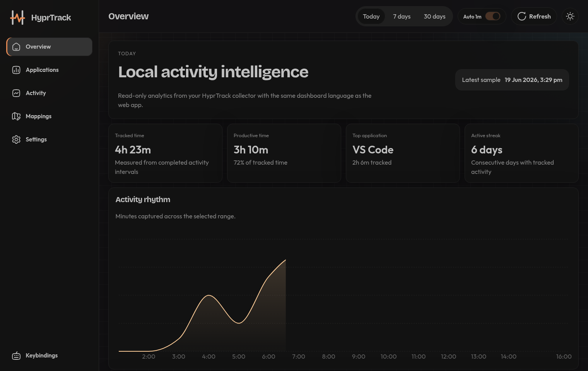
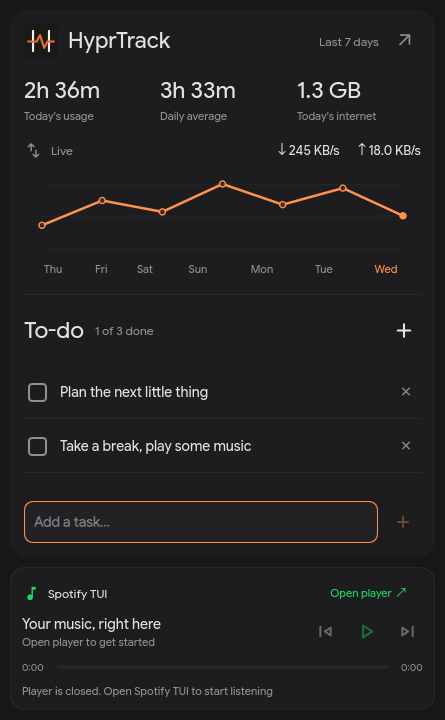
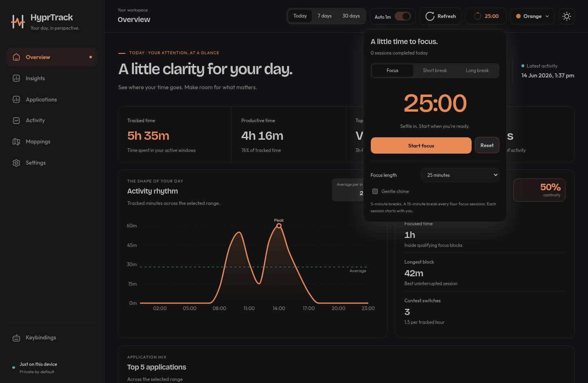

# HyprTrack

Local screen-time and internet usage tracking for Arch Linux + Hyprland.
See where your time goes, which apps use your connection, and how your focus changes through the day. Activity history stays on your machine in SQLite. No account required.

[Download](https://github.com/wrestle-R/HyprTrack/releases/latest) · [Website](https://hyprtrack-delta.vercel.app) · [Handbook](https://hyprtrack-delta.vercel.app/docs)

Track application usage and window titles, browse activity sessions, and check download and upload totals in Dataflow. A built-in Pomodoro timer helps with focus blocks. Six colour palettes support light, dark, and system appearance.

## Widgets

Today's usage, daily average, internet totals, and live network speed in the Hyprland sidebar.

The screenshot uses generic data. This optional [end-4 sidebar integration](https://github.com/wrestle-R/Linux/tree/main/End-4/sidebar) is maintained separately from the desktop app.

## Pomodoro

Built for x86_64 Arch Linux with Hyprland. Internet tracking requires separate NetHogs setup. Detailed activity is kept for 30 complete days plus today, with daily app totals retained indefinitely. See the [handbook](https://hyprtrack-delta.vercel.app/docs) for setup, updates, and data backups.

[MIT license](LICENSE)
